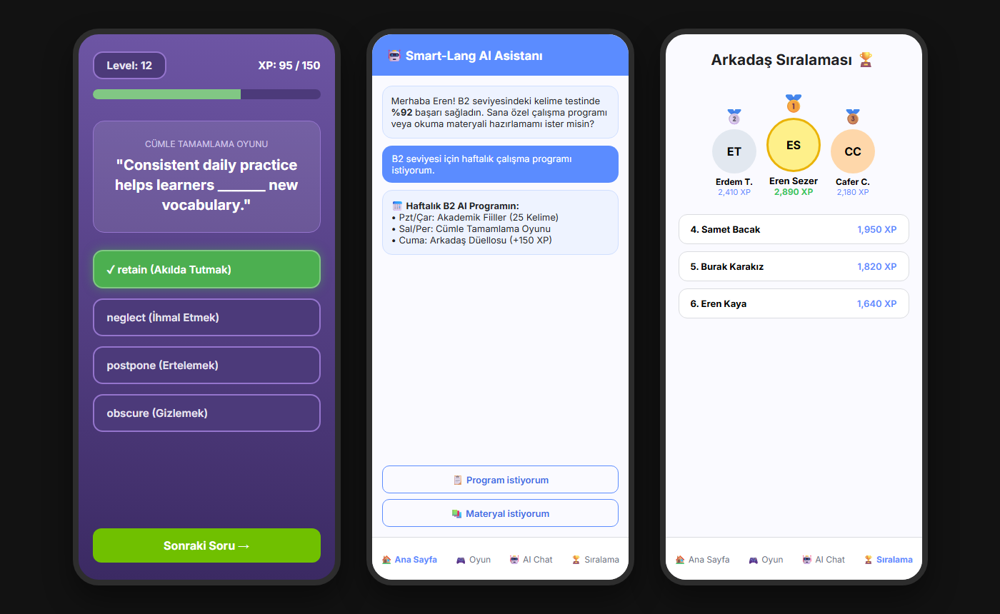

# 📱 Smart-Lang — Yapay Zeka Destekli İngilizce Pratik ve Kelime Oyunu (Android)

## 🎯 Proje Amacı
Kullanıcılara kelime ve cümle temelli oyunlarla dil öğrenmeyi eğlenceli hale getiren, istatistiksel ilerlemeyi gösteren, yapay zeka destekli kişisel çalışma programı hazırlayan ve arkadaş sıralamasıyla rekabet unsuru ekleyen bir Android uygulaması geliştirmek.

## 📸 Uygulama Ekran Görüntüleri (GameActivity • AiChatFragment • LeaderboardFragment)

---

## 🧩 Ana Özellikler
- Günlük çalışma hatırlatıcı (bildirim sistemi)
- Kelime ve cümle oyunları
- Kullanıcı istatistikleri ve görselleştirme
- Firebase tabanlı oturum açma (Auth) ve veri saklama (Firestore / Realtime DB)
- Arkadaş karşılaştırmaları (rekabet sistemi)
- Yapay zekâ destekli öneriler

---

## 🧱 Mimari
- **MVVM (Model-View-ViewModel)** yapısı
- **Firebase** (Auth, Firestore, Storage)
- **Yerel veriler için Room (opsiyonel cache)**
- **Retrofit / OpenAI API** (AI modülü)
- **Java dili (ana)**

---

## 👥 Ekip ve Görevler

| Rol                                 | Sorumluluklar | Üye                         |
|-------------------------------------|----------------|-----------------------------|
| 🔹Proje Mimarisi + Firebase Backend | Proje yapısı, Firebase bağlantısı, GitHub düzeni | Cafer Ceviz                 |
| 🔹 Local Database                   | Room, DAO, offline cache yapısı | Burak Karakız               |
| 🔹 UI / Grafik Tasarım              | Ekran tasarımları, layout yapıları | Eren Kaya & Muhammed Sultan |
| 🔹 İçerik / Oyun                    | Oyun mantığı, kelime ve cümle içerikleri | Erdem Taşar & Eren Sezer    |
| 🔹 AI / API                         | OpenAI, TTS, öneri sistemi | Samet Bacak                 |

---

## 🧠 Kullanılan Teknolojiler
- **Android Studio (Java)**
- **Firebase Auth + Firestore + Storage**
- **Room / ViewModel / LiveData**
- **Retrofit / JSON Parsing**
- **Material Design Components**
- **Git + GitHub Workflow**

---

## 🔄 Geliştirme Süreci
### Branch Yapısı
- `main` → kararlı sürüm
- `develop` → aktif geliştirme
- `feature/*` → yeni özellik geliştirme

### Kurallar
- Her yeni özellik için `feature/özellik-adi` branch açılır.
- PR(Pull Request) oluşturulmadan `develop`’a direkt push yapılmaz.
- Merge öncesi kod kontrolü yapılır.

---

